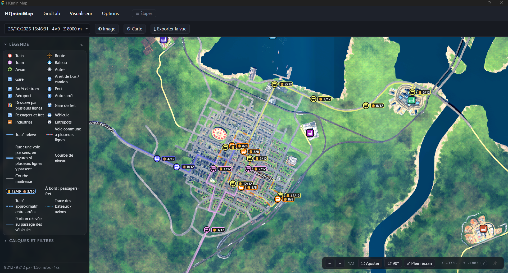
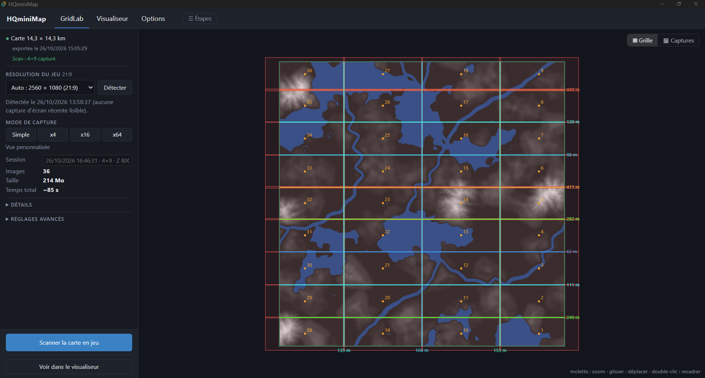
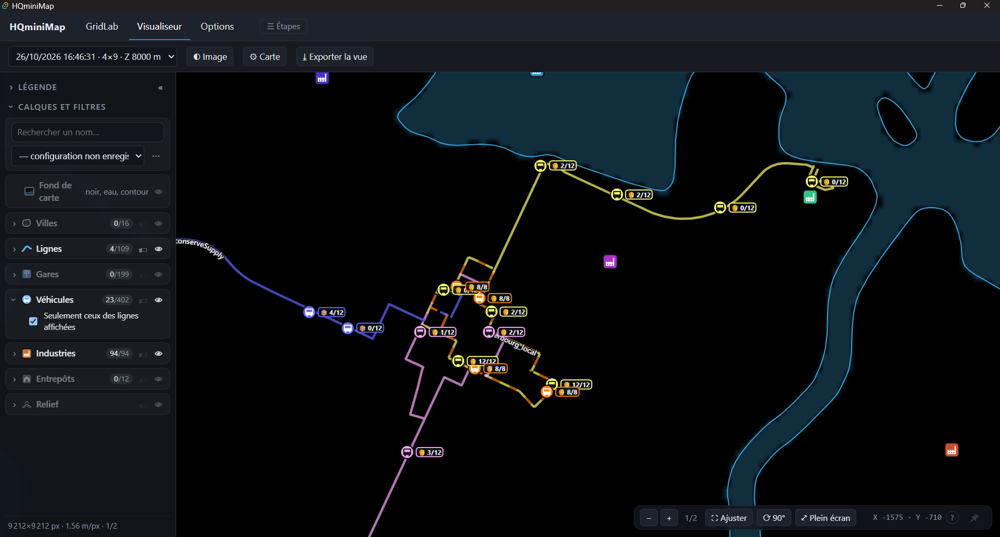
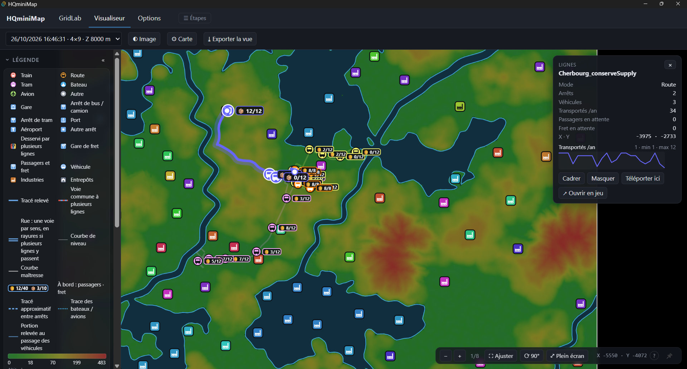

<p align="center">
  
</p>

<h1 align="center">HQminiMap</h1>

<p align="center">
  <b>Une carte haute résolution de ton monde Transport Fever 3, avec ton réseau en direct par-dessus.</b>
</p>

<p align="center">
  🌐 English · Français · Deutsch · Italiano · Español · 简体中文<br>
  💻 Windows · Linux · macOS
</p>

<p align="center">
  <a href="https://github.com/Spit8/HQminiMap/releases/latest"><b>⬇ Télécharger l'app</b></a> ·
  <a href="https://mod.io/g/transportfever3/m/<<MODIO_SLUG>>"><b>🧩 Le mod (Mod Hub)</b></a> ·
  <a href="README.md">🇬🇧 English version</a>
</p>



HQminiMap photographie ta carte vue du dessus, assemble les images en une **orthophoto** nette et l'affiche
dans un visualiseur rapide, avec **villes, lignes, gares, véhicules, industries et entrepôts** mis à jour en
direct depuis ta partie. Zoome jusqu'au pixel, filtre ce qui compte, déplace la caméra du jeu d'un double-clic
et exporte de belles images de ta carte.

## Fonctionnalités

| | |
|---|---|
|  |  |
| **Scanne ta carte en un clic.** Choisis un mode (Simple, x4, x16 ou x64 images) : GridLab règle la grille, la caméra et l'éclairage pour ta carte et ta résolution. Le scan se lance en jeu depuis l'app. | **Lis ton réseau d'un coup d'œil.** Affiche l'orthophoto, ou passe à un fond de carte épuré (fond noir, eau en bleu, contour de la carte) qui fait ressortir tes lignes. |
|  |  |
| **Vois le terrain.** Colore la carte selon l'altitude, trace les courbes de niveau, ou les deux, avec ta propre échelle de couleurs. | **Clique sur tout.** Chaque objet a sa fiche : chiffres, stocks, historique, et les boutons *Cadrer*, *Masquer*, *Téléporter ici* et *Ouvrir en jeu*. |

- **Données en direct de ta partie :** villes (avec leurs contours), lignes sur leur vrai tracé aux couleurs du jeu, gares et arrêts, véhicules animés avec leur chargement, industries et entrepôts avec leurs stocks.
- **Lignes comme dans le jeu :** un tronçon commun à plusieurs lignes est tracé en pointillés multicolores, une rue parcourue dans les deux sens en deux traits côte à côte.
- **Filtres :** recherche par nom, mode de transport, trafic minimal, stock minimal, sélection de lignes, lignes inactives. Enregistre des configurations nommées, charges-en une au démarrage, importe ou exporte-les en JSON.
- **Pilote le jeu depuis la carte :** double-clique sur un endroit pour y amener la caméra du jeu, ou sur un véhicule, une ligne, un arrêt, une usine ou un entrepôt pour ouvrir sa fenêtre en jeu.
- **Réglages d'image :** luminosité, contraste, saturation et gamma, en automatique ou à la main.
- **Exporte la vue** en PNG ×1, ×2 ou ×4, avec tes filtres et une légende en option.
- **Six langues :** anglais, français, allemand, italien, espagnol et chinois simplifié.

## Comment ça marche

HQminiMap a deux parties qui communiquent par fichiers, dans le dossier de données du jeu. Ni serveur, ni compte.

```
 Transport Fever 3                         Application HQminiMap
┌────────────────────────┐   fichiers     ┌──────────────────────────────────────┐
│ mod HQminiMap           │  données TF3   │ GridLab  grille, captures → ortho    │
│  • export de la carte   │ ─────────────► │                                      │
│  • captures vues du haut│                │ Visualiseur  ortho + données en      │
│  • données en direct    │ ◄───────────── │              direct, filtres, export │
└────────────────────────┘ scan, réglages,└──────────────────────────────────────┘
                            caméra
```

- **Le mod** (dans le jeu) exporte le contour et le relief de la carte, prend les captures vues du dessus et publie les données de ta partie.
- **L'app** (sur ton ordinateur) prépare le scan, calcule l'orthophoto et affiche le tout dans le visualiseur.

## Installation

Il te faut **les deux** : le mod et l'app.

### 1. Le mod
**Mod Hub (conseillé) :** dans le menu principal du jeu, ouvre le **Mod Hub**, cherche **HQminiMap** et
abonne-toi (ou abonne-toi sur [mod.io](https://mod.io/g/transportfever3/m/<<MODIO_SLUG>>)). Active ensuite **HQminiMap** dans la liste des mods de ta partie.

**À la main :** télécharge `hqminimap-mod-<version>.zip` depuis la page [Releases](https://github.com/Spit8/HQminiMap/releases/latest),
décompresse-le et copie le dossier `hqminimap` dans le dossier `mods` des données du jeu :
- Steam : `<Steam>\userdata\<SteamID>\3493540\local\mods\` (sous Windows, `<Steam>` est par défaut
  `C:\Program Files (x86)\Steam`, et `<SteamID>` est le numéro de ton compte Steam) ;
- GOG et Epic Games Store : `%APPDATA%\Transport Fever 3\mods\`.

Active-le ensuite dans le jeu.

### 2. L'application
Télécharge le fichier de ton système depuis la page [Releases](https://github.com/Spit8/HQminiMap/releases/latest) :

| Système | Fichier |
|---|---|
| Windows | `HQminiMap_<version>_x64-setup.exe` (ou le `.msi`) |
| Windows, sans installation | `HQminiMap_<version>_x64-portable.zip` : décompresse-le où tu veux et lance `HQminiMap.exe` |
| Linux | `.AppImage` (portable) ou `.deb` |
| macOS (Apple Silicon et Intel) | `.dmg` |

- **Windows** a besoin de Microsoft WebView2, déjà présent sur Windows 11 et la plupart des Windows 10. Les installeurs l'ajoutent s'il manque. Le zip portable fournit `MicrosoftEdgeWebview2Setup.exe` : lance-le seulement si l'app ne démarre pas.
- **Les installeurs ne sont pas encore signés**, le premier lancement demande donc une confirmation :
  - Windows SmartScreen : *Informations complémentaires* → *Exécuter quand même* ;
  - macOS Gatekeeper : clic droit sur l'app → *Ouvrir*.
- Au premier lancement, l'app trouve seule le dossier de données du jeu. Sinon, choisis le dossier de données du jeu dans **Options** (Steam : `<Steam>/userdata/<SteamID>/3493540/local`). L'app trouve aussi le mod, qu'il vienne du Mod Hub ou soit installé à la main.

### Mises à jour
- **L'app** cherche les nouvelles versions au démarrage (**Options**). Installée (ou en AppImage), elle se met à jour elle-même avec *Installer et redémarrer*. Le zip portable et le `.deb` affichent un lien vers la nouvelle version.
- **Le mod** est mis à jour par le Mod Hub (ou en remplaçant le dossier `hqminimap`).
- **Après une mise à jour du mod, recharge ta sauvegarde** : le jeu garde l'ancien code du mod jusque-là. L'app affiche un bandeau tant que le jeu exécute un mod plus ancien qu'elle.

## Prise en main

### Construis ta carte
1. **Dans le jeu :** clique sur le bouton HQminiMap de la barre du bas, puis **Exporter la carte**.
2. **Dans l'app, GridLab** (ouvert au premier lancement) : choisis un **mode de capture** :
   - **Simple** (environ 1 image, très rapide), **x4**, **x16** ou **x64** (environ 64 images, le plus de détail) ;
   - le résumé donne le nombre d'images, la taille de l'orthophoto et le temps total ;
   - les **Réglages avancés** permettent de changer la résolution du jeu (détectée sur ta dernière capture d'écran), l'altitude, le champ de vision, la grille, l'éclairage et l'interpolation.
3. Clique sur **Scanner la carte en jeu**. Le scan démarre aussitôt dans ta partie ; inutile d'ouvrir la fenêtre du mod.
4. L'app récupère les captures, **calcule l'orthophoto toute seule** et l'ouvre dans le **Visualiseur**. La barre des **Étapes**, en haut, montre où tu en es.

### Explore-la dans le Visualiseur
- Zoom jusqu'au pixel, rotation, **Plein écran** (touche **F**), **Ajuster** pour voir toute la carte (touche **0**).
- **Calques et filtres** (touche **L**) : active ou masque les calques, affiche les étiquettes, filtre par nom, mode, trafic, stock ou ligne, et enregistre tes configurations.
- **Relief** : couleurs selon l'altitude, courbes de niveau, ou les deux.
- **Fond de carte** : l'orthophoto, ou un fond uni avec l'eau en bleu et le contour de la carte.
- **Image** : luminosité, contraste, saturation et gamma.
- **Carte** : taille des icônes et des textes, opacité des lignes, chargement des véhicules.
- **Clic** sur un objet : sa fiche. **Double-clic** sur la carte : la caméra du jeu s'y déplace.
- **Exporter la vue** enregistre un PNG (×1, ×2 ou ×4), avec une légende en option.

### Données en direct
Le mod publie les données de ta partie aux cadences réglées dans **Options → Données en direct**. Le tableau donne le coût de chaque mise à jour et la part du temps du jeu utilisée : tu peux ainsi garder un jeu fluide sur les grandes cartes.

### Langue
L'app suit la langue du système au premier lancement ; change-la dans **Options → Langue**. La fenêtre en jeu suit la langue du jeu.

## Limites connues
- Une **ligne récente** peut montrer des portions provisoires (trait fin ou tirets) jusqu'à ce que le jeu ait calculé tout son tracé.
- Les **contours de villes** sont recalculés toutes les 2 minutes environ à partir des bâtiments.
- Les installeurs ne sont **pas encore signés** (voir *Installation*).

## À venir
Des idées pour les prochaines versions, sans promesse : support smartphone et tablette, icônes originales du
jeu, générateur de diagrammes, dessin sur la carte, filtres croisés plus riches. Les suggestions sont les
bienvenues dans les [Issues](https://github.com/Spit8/HQminiMap/issues).

## Contribuer et traduire
- Bugs et idées : [GitHub Issues](https://github.com/Spit8/HQminiMap/issues).
- Compiler depuis les sources : [docs/DEVELOPMENT.md](docs/DEVELOPMENT.md).
- Ajouter ou améliorer une langue : [docs/TRANSLATING.md](docs/TRANSLATING.md).

## Licence
[GPL-3.0](LICENSE) © 2026 Wilfried Lambert.

Transport Fever est une marque d'Urban Games. HQminiMap est un projet de fan indépendant, ni affilié ni approuvé par Urban Games.
