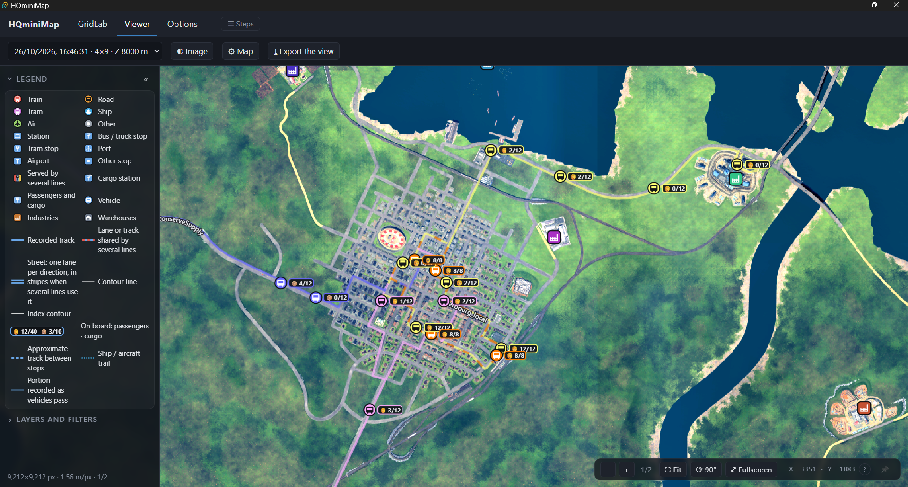
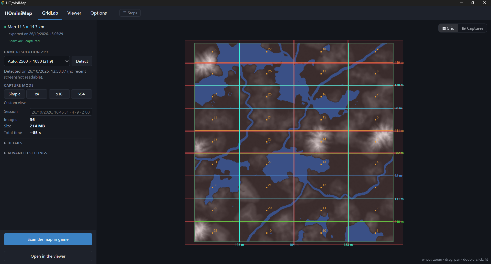
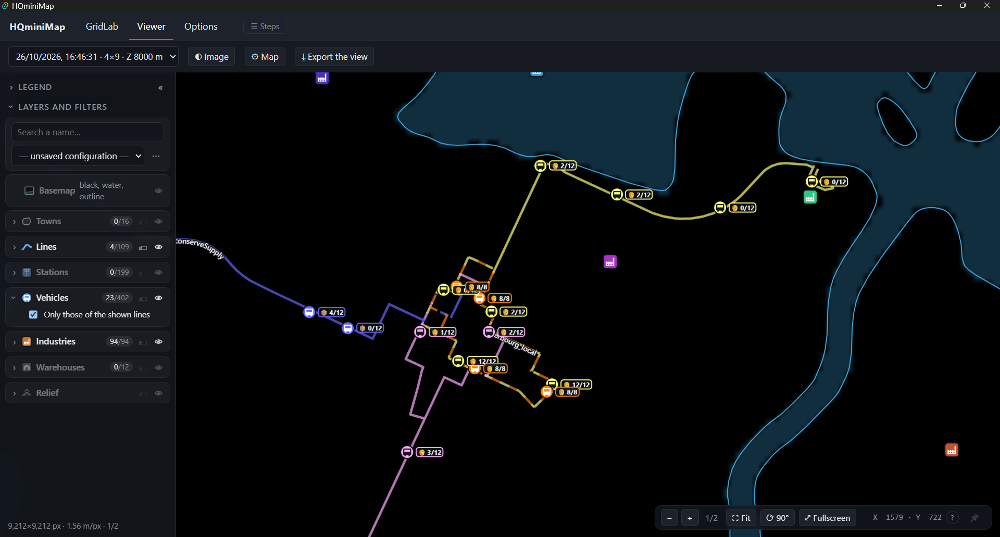
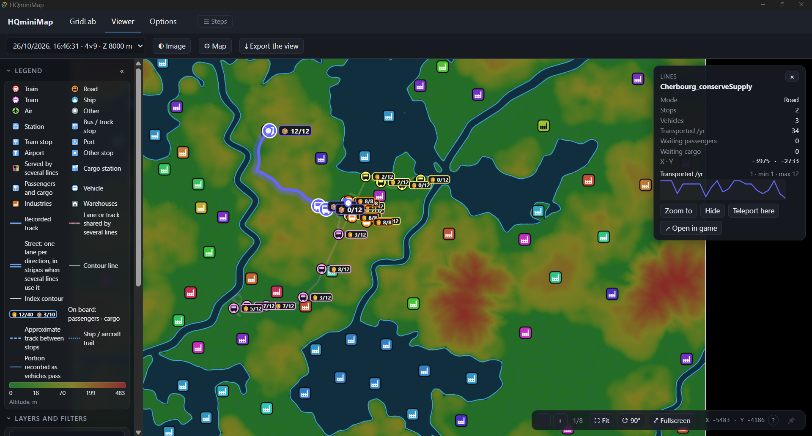

<p align="center">
  
</p>

<h1 align="center">HQminiMap</h1>

<p align="center">
  <b>A high-resolution map of your Transport Fever 3 world, with your network live on top of it.</b>
</p>

<p align="center">
  🌐 English · Français · Deutsch · Italiano · Español · 简体中文<br>
  💻 Windows · Linux · macOS
</p>

<p align="center">
  <a href="https://github.com/Spit8/HQminiMap/releases/latest"><b>⬇ Download the app</b></a> ·
  <a href="https://mod.io/g/transportfever3/m/<<MODIO_SLUG>>"><b>🧩 Get the mod (Mod Hub)</b></a> ·
  <a href="README.fr.md">🇫🇷 Version française</a>
</p>



HQminiMap scans your map from above, stitches the screenshots into one sharp **orthophoto**, and shows it in a
fast viewer with **towns, lines, stations, vehicles, industries and warehouses** updated live from your game.
Zoom down to the pixel, filter what matters, teleport the game camera with a double-click, and export
beautiful map images.

## Features

| | |
|---|---|
|  |  |
| **Scan your map in one click.** Pick a mode (Simple, x4, x16 or x64 images) and GridLab sets the grid, camera and lighting for your map and your screen resolution. The scan starts in game from the app. | **Read your network at a glance.** Show the orthophoto, or switch to a clean basemap (black background, blue water, map outline) that lets your lines stand out. |
|  |  |
| **See the terrain.** Colour the map by altitude, draw contour lines, or both, with your own colour scale. | **Click anything.** Each object has a card with its figures, stocks and history, plus *Zoom to*, *Hide*, *Teleport here* and *Open in game*. |

- **Live data from your game:** towns (with their outlines), lines drawn along their real tracks in the game's colours, stations and stops, moving vehicles with their load, industries and warehouses with their stocks.
- **Lines as in the game:** stretches shared by several lines are drawn as multi-colour dashes, and two-way streets as two strokes side by side.
- **Filters:** search by name, transport mode, minimum traffic, minimum stock, chosen lines, inactive lines. Save named filter setups, load one at startup, import or export them as JSON.
- **Control the game from the map:** double-click a spot to move the game camera there, or a vehicle, line, stop, factory or warehouse to open its in-game window.
- **Image settings:** brightness, contrast, saturation and gamma, automatic or by hand.
- **Export the view** as a PNG at ×1, ×2 or ×4, with your filters and an optional legend.
- **Six languages:** English, French, German, Italian, Spanish and Simplified Chinese.

## How it works

HQminiMap has two parts that talk to each other through files in the game's data folder. No server, no account.

```
 Transport Fever 3                        HQminiMap app
┌────────────────────────┐   files in    ┌─────────────────────────────────────┐
│ HQminiMap mod           │  TF3 data     │ GridLab  grid, screenshots → ortho  │
│  • map export           │ ────────────► │                                     │
│  • top-down screenshots │               │ Viewer   ortho + live data,         │
│  • live game data       │ ◄──────────── │          filters, export            │
└────────────────────────┘ scan, settings,└─────────────────────────────────────┘
                            camera moves
```

- **The mod** (in game) exports the map outline and relief, takes the top-down screenshots and publishes your game data.
- **The app** (on your desktop) plans the scan, builds the orthophoto and shows everything in the viewer.

## Installation

You need **both** the mod and the app.

### 1. The mod
**Mod Hub (recommended):** in the game's main menu, open the **Mod Hub**, search for **HQminiMap** and
subscribe (or subscribe on [mod.io](https://mod.io/g/transportfever3/m/<<MODIO_SLUG>>)). Then enable **HQminiMap** in the mod list of your save.

**By hand:** download `hqminimap-mod-<version>.zip` from the [Releases](https://github.com/Spit8/HQminiMap/releases/latest)
page, unzip it, and copy the `hqminimap` folder into the `mods` folder of the game's data folder:
- Steam: `<Steam>\userdata\<SteamID>\3493540\local\mods\` (on Windows, `<Steam>` is by default
  `C:\Program Files (x86)\Steam`, and `<SteamID>` is the number of your Steam account);
- GOG and Epic Games Store: `%APPDATA%\Transport Fever 3\mods\`.

Then enable it in game.

### 2. The app
Download the file for your system from the [Releases](https://github.com/Spit8/HQminiMap/releases/latest) page:

| System | File |
|---|---|
| Windows | `HQminiMap_<version>_x64-setup.exe` (or the `.msi`) |
| Windows, no install | `HQminiMap_<version>_x64-portable.zip`: unzip anywhere and run `HQminiMap.exe` |
| Linux | `.AppImage` (portable) or `.deb` |
| macOS (Apple Silicon and Intel) | `.dmg` |

- **Windows** needs Microsoft WebView2, already present on Windows 11 and most Windows 10 PCs. The installers add it if it is missing. The portable zip includes `MicrosoftEdgeWebview2Setup.exe`: run it only if the app does not start.
- **The installers are not signed yet**, so the first launch asks for a confirmation:
  - Windows SmartScreen: *More info* → *Run anyway*;
  - macOS Gatekeeper: right-click the app → *Open*.
- On first launch the app finds the game's data folder by itself. If it does not, pick the game's data folder in **Options** (Steam: `<Steam>/userdata/<SteamID>/3493540/local`). The app also finds the mod, whether it comes from the Mod Hub or was installed by hand.

### Updates
- **The app** checks for new versions at startup (**Options**). Installed versions (and the AppImage) update themselves with *Install and restart*. The portable zip and the `.deb` show a link to the new version.
- **The mod** is updated by the Mod Hub (or by replacing the `hqminimap` folder).
- **After a mod update, reload your save**: the game keeps the old mod code until then. The app shows a banner while the game runs an older mod than the app.

## Getting started

### Build your map
1. **In game:** click the HQminiMap button in the bottom bar, then **Export map**.
2. **In the app, GridLab** (opens on first launch) — choose a **capture mode**:
   - **Simple** (about 1 image, very quick), **x4**, **x16** or **x64** (about 64 images, the most detail);
   - the summary shows the number of images, the size of the orthophoto and the total time;
   - **Advanced settings** let you change the game resolution (detected from your latest screenshot), the altitude, the field of view, the grid, the lighting and the interpolation.
3. Click **Scan the map in game**. The scan starts right away in your running game; you do not need to open the mod window.
4. The app collects the screenshots, **builds the orthophoto by itself** and opens it in the **Viewer**. The **Steps** bar at the top shows where you are.

### Explore it in the Viewer
- Zoom down to the pixel, rotate, **Fullscreen** (key **F**), **Fit** to see the whole map (key **0**).
- **Layers and filters** (key **L**): turn layers on and off, show labels, filter by name, mode, traffic, stock or line, and save your filter setups.
- **Relief**: colours by altitude, contour lines, or both.
- **Basemap**: the orthophoto, or a plain background with blue water and the map outline.
- **Image**: brightness, contrast, saturation and gamma.
- **Map**: icon and text size, line opacity, vehicle loads.
- **Click** an object for its card. **Double-click** the map to move the game camera there.
- **Export the view** to save a PNG (×1, ×2 or ×4), with an optional legend.

### Live data
The mod publishes your game data at the rates set in **Options → Live data**. The table shows the cost of each update and the share of the game's time it uses, so you can keep the game smooth on big maps.

### Language
The app follows your system language on first launch; change it in **Options → Language**. The in-game window follows the game's language.

## Known limitations
- A **new line** may show provisional parts (thin or dashed) until the game has computed its whole track.
- **Town outlines** are recomputed about every 2 minutes from the buildings.
- The installers are **not signed** yet (see *Installation*).

## More to come
Ideas for the next versions, without promises: smartphone and tablet support, original game icons, a diagram
generator, drawing on the map, and richer (cross-)filtering. Suggestions are welcome in the
[Issues](https://github.com/Spit8/HQminiMap/issues).

## Contributing and translating
- Bug reports and ideas: [GitHub Issues](https://github.com/Spit8/HQminiMap/issues).
- Building from source: [docs/DEVELOPMENT.md](docs/DEVELOPMENT.md).
- Adding or improving a language: [docs/TRANSLATING.md](docs/TRANSLATING.md).

## License
[GPL-3.0](LICENSE) © 2026 Wilfried Lambert.

Transport Fever is a trademark of Urban Games. HQminiMap is an independent fan project, neither affiliated with nor endorsed by Urban Games.
